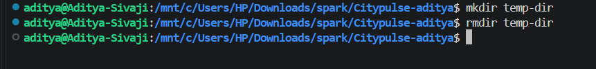
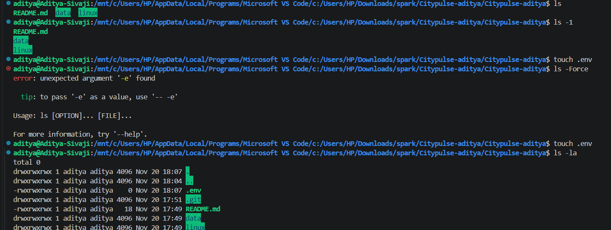

# Atria-CityPulse

This repository documents basic Linux command-line tasks and includes screenshots of the commands being run in the terminal.

## Task 1: Remove Directories

Use `mkdir` to create a directory and `rmdir` to remove an empty directory.

```bash
mkdir temp-dir
rmdir temp-dir
```

`rmdir` only works when the directory is empty. Use `rm -r` or `rm -rf` to remove directories that contain files or subdirectories.



## Task 2: Remove Files and Directories Recursively

Use `rm` to remove a file and `rm -r` or `rm -rf` to remove a directory and everything inside it.

```bash
# Remove a file
rm filename.txt

# Remove a directory and its contents interactively
rm -r folder-name

# Remove a directory and its contents without prompting
rm -rf folder-name
```

> Warning: `rm -rf` permanently deletes data. Double-check the path before running it.

## Task 3: Rename Files and Check Disk Usage

### Rename a File or Directory

The `mv` command renames a file or directory:

```bash
mv old-name.txt new-name.txt
mv old-folder-name new-folder-name
```

To move and rename a file at the same time:

```bash
mv filename.txt folder/filename.txt
```

### Check Disk Usage

Use `df -h` to see the disk space available on mounted filesystems:

```bash
df -h
```

Use `du -h` to show the size of files and directories:

```bash
# Show the size of the current directory
du -h

# Show only the size of the current directory summary
du -sh

# Show the size of a specific folder
du -sh folder-name
```


